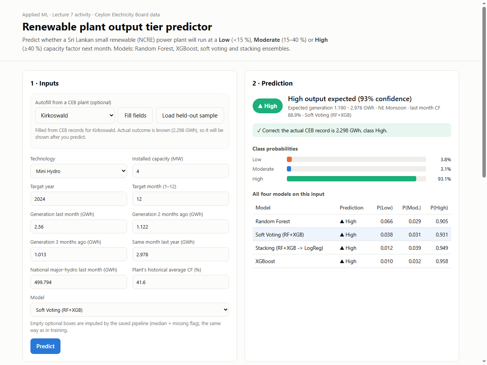
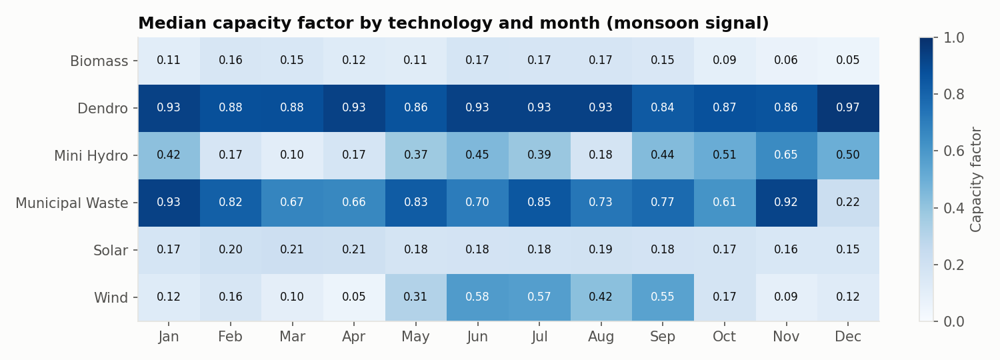
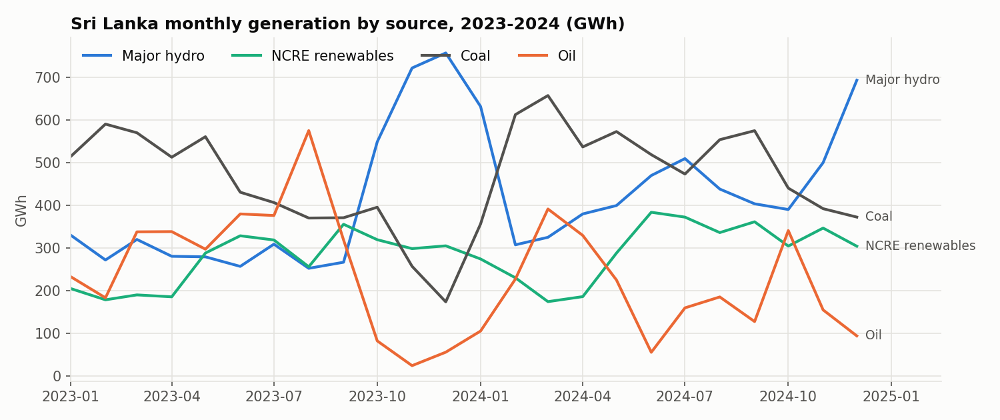
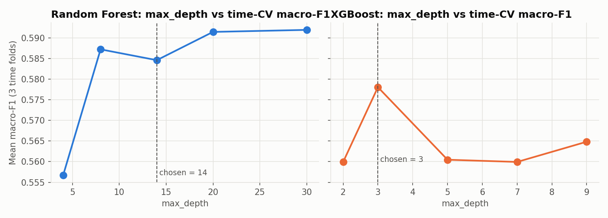
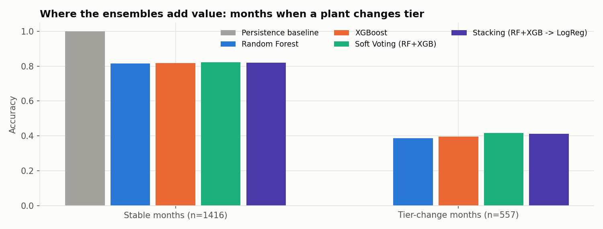
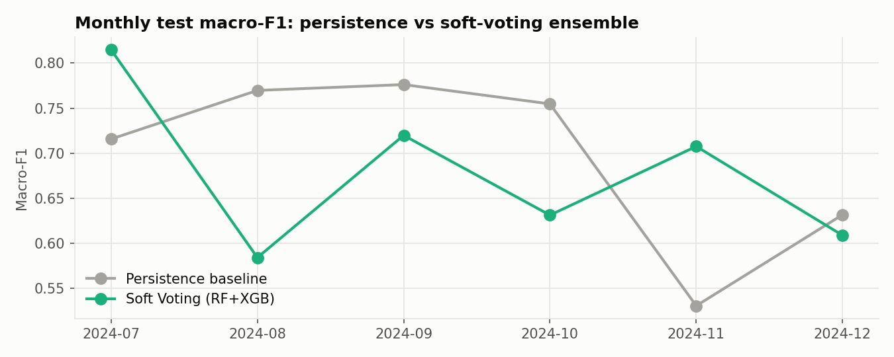
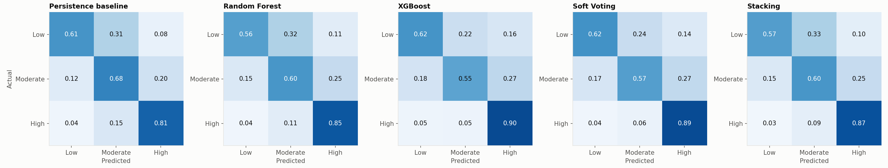
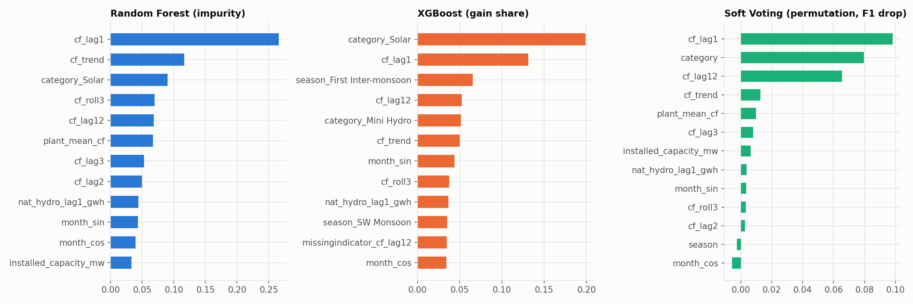

# Will a Sri Lankan renewable plant under-deliver next month?
### Random Forest vs XGBoost (+ Soft Voting and Stacking) on Ceylon Electricity Board data

ML Lecture 7 class activity. The dataset is **local and public**: monthly generation of every small renewable (NCRE)
power plant connected to the CEB grid, 2023–2024.



| Guideline step | Where in this repo |
|---|---|
| 1. Local Sri Lankan dataset | `data/raw/` (CEB statistical reports) |
| 2. Preprocessing: null detection, imputation, transformations, normalising, scaling | `src/data_prep.py`, `src/models.py` (`make_preprocessor`) |
| 3. Random Forest + XGBoost | `src/models.py` |
| 4. Self-designed (non-default) parameters | `src/models.py` (reasoning beside every value), validation curve |
| 5. Compare, strengths/limitations, interpretation | `notebooks/CEB_NCRE_Ensemble_Activity.ipynb` §5–6, section 6 below |
| 6. Single-sample inference + `.pkl` | `src/predict.py`, `models/model.pkl`, notebook §7 |
| 7. GenAI pickle loader + front end | `app/`, prompts in `docs/genai_prompts.md` |
| Optional: Stacking (+ soft voting) | `src/models.py`, compared everywhere |

## Quick start (Windows, Python 3.11)

```powershell
cd "path\to\Activity"
python -m venv .venv                      # 1. create a private Python environment (once)
.venv\Scripts\activate                    # 2. switch it on (every new terminal)
pip install -r requirements.txt           # 3. install packages (once)
python app/app.py                         # 4. start the website -> open http://127.0.0.1:5000
```
The trained models are already in `models/`, so step 4 works immediately. To rebuild everything from the raw CSVs, run `python run_all.py` (about 3 minutes).
On macOS/Linux, activate with `source .venv/bin/activate`.

New to the project? [`docs/PROJECT_GUIDE.md`](docs/PROJECT_GUIDE.md) explains every step, file and concept, following one real plant through the whole pipeline.

---

## 1. Problem

Sri Lanka targets **70 % renewable electricity by 2030** (it reached 60 % in 2025). More than 330 small NCRE plants
(mini-hydro, solar, wind, dendro, biomass, waste-to-energy) feed the grid, and their output rises and falls with the **South-West (May–Sep) and
North-East (Dec–Feb) monsoons**. When these plants under-deliver, CEB has to burn more imported coal and oil.

**Classification task:** before a month starts, predict each plant's **capacity-factor tier** for that month:

| Class | CF = GWh ÷ (MW × hours) | Meaning |
|---|---|---|
| **Low** | < 15 % | drought, outage, maintenance |
| **Moderate** | 15–40 % | normal solar/wind, average mini-hydro |
| **High** | ≥ 40 % | monsoon-fed hydro, firm dendro/waste |

Class balance after cleaning: Low 26 % · Moderate 43 % · High 31 % (7,313 plant-months, 331 plants).

## 2. Data

| File | Rows | Use |
|---|---|---|
| `ceb_ncre_plant_monthly.csv` | 7,968 | main dataset: plant, category, MW, monthly GWh (2023–2024) |
| `ceb_monthly_generation_by_source.csv` | 288 | national generation by source: previous-month major-hydro (rainfall proxy), EDA |
| `ceb_system_summary_2023_2025.csv` | 3 | national renewable share (context) |

Source: CEB *Sales & Generation Data Books 2023/2024* and *Statistical Digest*, <https://ceb.lk/publication-media/statistical-reports/en>.

## 3. Preprocessing

The raw CSV has **zero explicit nulls**. The problems are hidden, and domain knowledge is what reveals them. Every step is logged in `data/processed/cleaning_log.json`.

| Issue | Treatment |
|---|---|
| `Other Renewables` is a 396 MW national aggregate | dropped (24 rows) |
| 2023 book truncates names (`Mahiyanganaya 2 SB-`) | auto-mapped to the unique 2024 name (13 plants, 156 rows) |
| One name, several units (Moragahakanda ×3, Gampola ×2) | unique `plant_id` per unit |
| Capacity differs across years (Ankanda 1.0 vs 6.5 MW) | max reported nameplate (3 plants) |
| **CF > 100 %**, physically impossible | **null detection**: set to NaN (31 rows) |
| 10 plants with zero output in all 24 months | dropped (never operated) |
| zeros before a plant's first output | dropped (99 rows; not outages) |
| missing lags (`cf_lag1` 18, `cf_lag2` 349, `cf_lag3` 682, `cf_lag12` 3,593) | **median imputation + missing-indicator** inside the pipeline |

**Transformations, normalisation and scaling**, all inside the saved sklearn `Pipeline`:
target normalised to capacity factor · `log1p` on skewed MW and hydro GWh · cyclical month (`sin`/`cos`) ·
Sri Lankan monsoon `season` · `StandardScaler` · one-hot `category`/`season`.

**Features:** `cf_lag1/2/3`, `cf_roll3`, `cf_trend`, `cf_lag12` (same month last year), `plant_mean_cf` (expanding mean of past months only),
`nat_hydro_lag1_gwh`, `installed_capacity_mw`, `month_sin/cos`, `category`, `season`.

**Split by time:** train Feb-2023 to Jun-2024 (5,339 rows) and test **Jul–Dec 2024** (1,973 rows). A random split would leak the future through lag features.
One sample, **Kirkoswald Dec-2024**, is held out of both for the inference demo.

| | |
|---|---|
|  |  |

## 4. Parameter engineering (no defaults)

| | Random Forest | XGBoost |
|---|---|---|
| trees | `n_estimators=500` (stable soft-vote probabilities) | `n_estimators=600`, `learning_rate=0.03` |
| depth | `max_depth=14` | `max_depth=3`: first design was 5, changed after the time-ordered validation curve below |
| leaf size | `min_samples_leaf=3`, `min_samples_split=6` | `min_child_weight=3` |
| randomness | `max_features=0.5`, `max_samples=0.8` | `subsample=0.8`, `colsample_bytree=0.8` |
| regularisation | n/a | `gamma=0.1`, `reg_lambda=2.0`, `reg_alpha=0.1` |
| imbalance | `class_weight=None`: `balanced_subsample` was tried and lowered macro-F1 (the imbalance is mild) | n/a |

Ensembles: `VotingClassifier(voting="soft")` (the lecturer's pipeline) and `StackingClassifier` (RF + XGB → `LogisticRegression(C=0.5)`, 5-fold out-of-fold probabilities).



## 5. Results: test set Jul–Dec 2024

| Model | Accuracy | Macro-F1 | Balanced acc. | ROC-AUC | Log-loss | Fit (s) |
|---|---|---|---|---|---|---|
| Persistence baseline (*same tier as last month*) | **0.718** | **0.698** | **0.699** | n/a | n/a | 0 |
| Random Forest | 0.695 | 0.669 | 0.673 | 0.850 | 0.681 | 2.8 |
| XGBoost | 0.699 | 0.672 | 0.687 | 0.855 | 0.711 | 1.4 |
| **Soft Voting (RF+XGB)** | **0.708** | **0.682** | **0.695** | **0.856** | **0.674** | 4.1 |
| Stacking (RF+XGB → LogReg) | 0.705 | 0.678 | 0.682 | 0.852 | 0.704 | 21.4 |

| | |
|---|---|
|  |  |




## 6. Interpretation

* **Soft voting is the best ML model** on every metric. It combines RF's well-calibrated probabilities with XGBoost's
  sharper boundaries. Stacking is close but costs 5× the training time for no gain on 5k rows.
* **Persistence is a very strong baseline.** 72 % of plant-months keep last month's tier, so "same as last month" scores
  macro-F1 0.698, slightly above every model. It is reported because hiding it would overstate the ML.
* **The ensembles add value where planning needs it:**
  * on the **557 tier-change months**, where persistence is always wrong, soft voting is right **42 %** of the time
  * at **monsoon transitions** it clearly wins: **July 2024 0.82 vs 0.72** and **November 2024 0.71 vs 0.53** (macro-F1)
  * **ROC-AUC 0.86**: plants can be ranked by P(Low) for maintenance and dispatch planning, which a rule cannot do
* **Drivers:** last month's CF, technology, same month last year and the plant's long-run mean. National hydro helps only a little: it is an island-wide signal, but mini-hydro responds to rain in its *own* catchment.
* **By technology:** wind 0.75–0.82 and solar 0.70–0.72 macro-F1. **Mini-hydro is hardest (0.53–0.55)** because local rainfall is missing.
* **Tried and rejected:** a gated hybrid (persistence unless the ensemble is confident). The gate chosen on the training-period
  validation window scored 0.690 on test, below persistence, so it was dropped (tuning it on the test set would be leakage).

| Model | Strengths | Limitations |
|---|---|---|
| Random Forest | robust, little tuning, best-calibrated single model, free OOB estimate (0.80) | 33 MB pickle; weaker on the Low class |
| XGBoost | best single-model ROC-AUC, shallow boosted trees capture season × lag effects, 2 MB pickle | more knobs; depth-sensitive; slightly over-confident |
| Soft Voting | best overall, simple, stable | 2× inference cost; cannot learn which model to trust per season |
| Stacking | learns combination weights | 5× training cost; no gain on a small dataset |

**Limitations of the study:** only 24 months (two monsoon cycles), no catchment-level rainfall, and the test covers only the second half of 2024.
**Next steps:** add Department of Meteorology district rainfall, and a longer history (2019–2022 data books).

## 7. Single-sample inference

```text
$ python -m src.predict
Left-out sample: Kirkoswald (Mini Hydro, 4.0 MW), 2024-12
Actual generation 2.298 GWh -> CF 77.2% -> TRUE class: High

Random Forest                  -> High  {'Low': 0.0657, 'Moderate': 0.0293, 'High': 0.9049}  (expected 1.190 - 2.976 GWh)
XGBoost                        -> High  {'Low': 0.01,   'Moderate': 0.0322, 'High': 0.9578}  (expected 1.190 - 2.976 GWh)
Soft Voting (RF+XGB)           -> High  {'Low': 0.0379, 'Moderate': 0.0308, 'High': 0.9314}  (expected 1.190 - 2.976 GWh)
Stacking (RF+XGB -> LogReg)    -> High  {'Low': 0.0121, 'Moderate': 0.0391, 'High': 0.9488}  (expected 1.190 - 2.976 GWh)
```
New data points: `python -m src.predict --category Solar --capacity 1 --year 2025 --month 1 --lag1 0.118 --hydro 692.8`

## 8. Front end

```bash
pip install -r requirements.txt
python app/app.py              # http://127.0.0.1:5000   (add /?demo to auto-run the held-out sample)
```
* text boxes for every model input (GWh history is converted to capacity factor exactly as in training)
* **autofill** from any of the 331 CEB plants for a chosen month; when the real outcome is known, the app shows whether the prediction was right
* probabilities, expected GWh range, and all four models side by side · JSON API `POST /api/predict`
* built from the GenAI prompts in [`docs/genai_prompts.md`](docs/genai_prompts.md)

## 9. Reproduce

```bash
pip install -r requirements.txt
python run_all.py              # data prep -> EDA -> train/evaluate (~3 min) -> holdout inference
python -m pytest -q            # smoke tests
python notebooks/build_notebook.py && python -m nbconvert --to notebook --execute --inplace notebooks/CEB_NCRE_Ensemble_Activity.ipynb
```

```
├── app/                 Flask front end (app.py, templates/, static/)
├── data/raw/            CEB CSVs (unchanged)
├── data/processed/      model_dataset.csv, cleaning_log.json, holdout_sample.json, plant_lookup.json
├── docs/genai_prompts.md
├── models/              model.pkl (soft voting), random_forest.pkl, xgboost.pkl, stacking.pkl, metadata.json
├── notebooks/           CEB_NCRE_Ensemble_Activity.ipynb (executed) + its builder script
├── reports/             metrics.csv, per-category / per-month / regime CSVs, figures/
├── src/                 config, data_prep, features, models, train, eda, predict, plotting
├── tests/test_smoke.py
└── run_all.py
```
The `.pkl` files were saved with scikit-learn 1.5.0 (pinned in `requirements.txt`). Each is under GitHub's 50 MB warning size.
