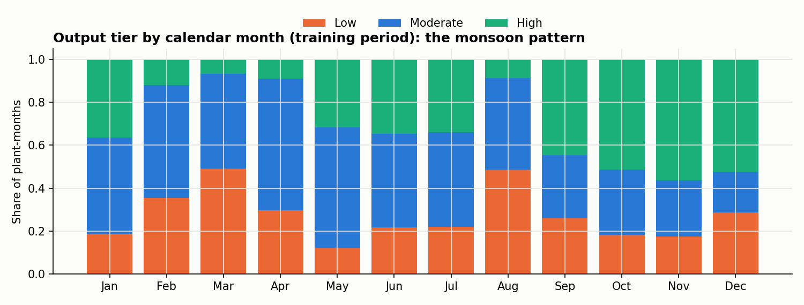
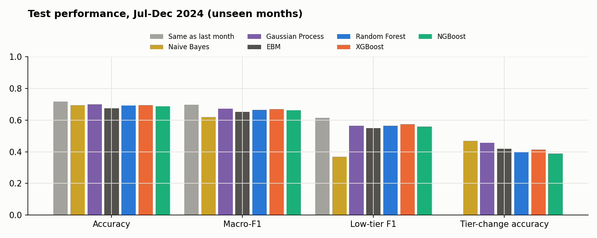
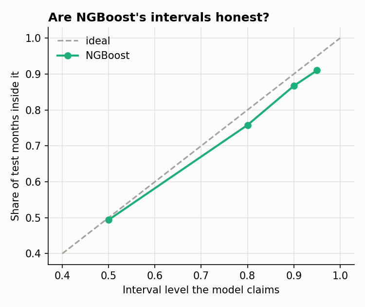
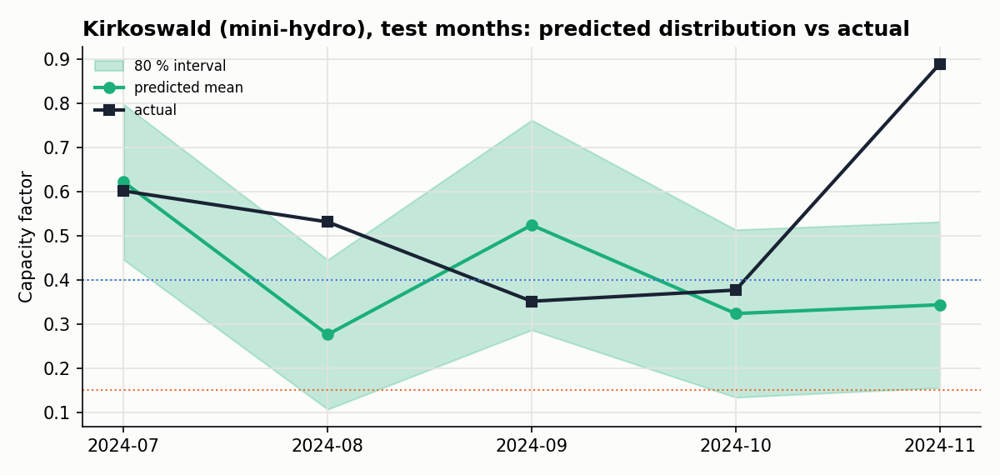
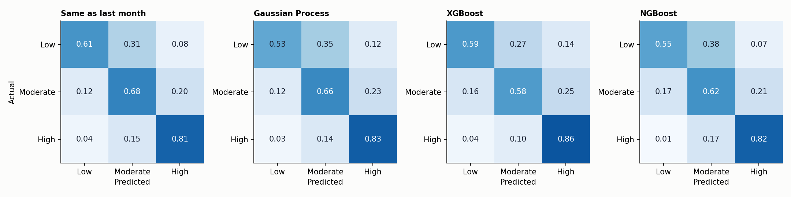
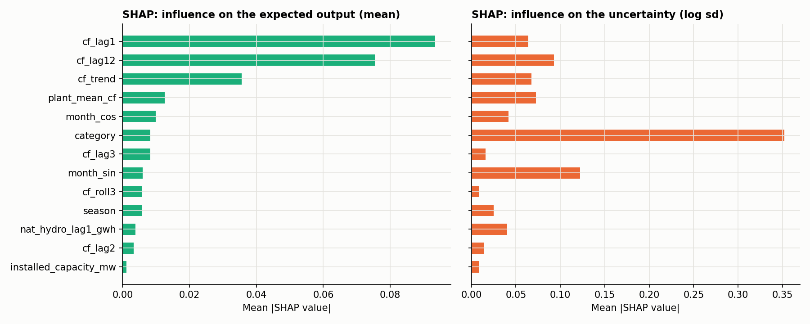
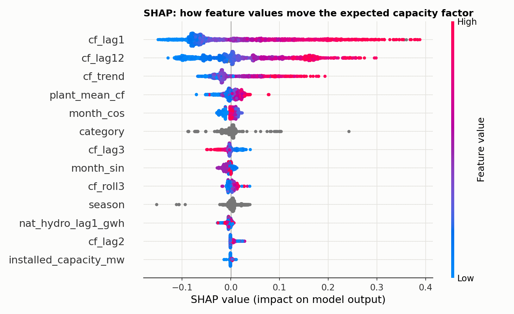
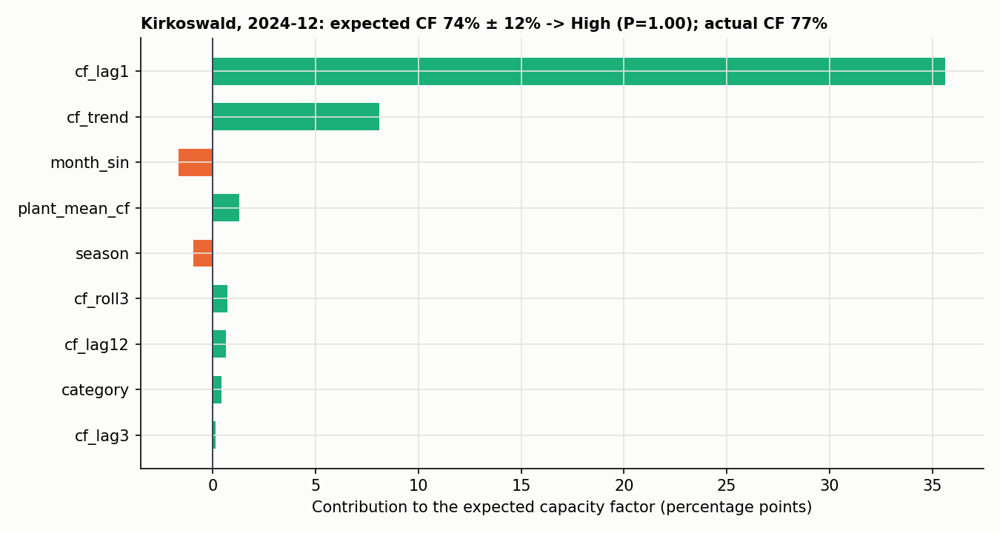
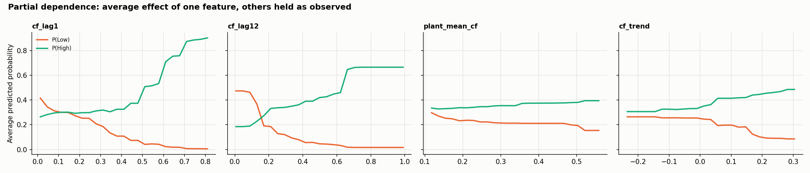

# Will a Sri Lankan renewable plant under-deliver next month?
### NGBoost (probabilistic boosting) on Ceylon Electricity Board data, 2023–2024

Predicts, before each month starts, whether each of Sri Lanka’s 331 small renewable (NCRE) power plants will have
**Low, Moderate or High** output. Main model: **NGBoost**, which predicts a full probability distribution of next
month’s capacity factor. Compared with two other algorithms not taught in the module (**Gaussian Process, Naive Bayes**)
and three covered in the module (**EBM, Random Forest, XGBoost**). Explained with NGBoost’s own importances, **SHAP,
LIME and partial dependence**, and served by a **Flask web app** that shows each prediction, its likely range *and*
its explanation.

**Live app:** https://ceb-plant-predictor-ajfua4b6ahd0g0g3.indiasouthcentral-01.azurewebsites.net/

## Project structure

```
├── data/
│   ├── raw/                 the 3 original CEB files (unchanged)
│   └── processed/           cleaned dataset + cleaning log (made by preprocess.py)
├── src/
│   ├── preprocess.py        cleaning, feature engineering, encoding, normalisation (+ shared settings)
│   ├── train.py             time split, hyperparameter tuning, model training, saves models/
│   ├── evaluate.py          metrics, significance tests, confusion matrices, plots -> outputs/
│   └── explain.py           NGBoost importances, SHAP, LIME, PDP -> outputs/
├── models/                  trained models (.pkl) + metadata.json
├── outputs/                 every table and figure used in the report
├── app/                     Flask web app (app.py, templates/, static/)
└── requirements.txt
```

## How to run (Windows, Python 3.11)

```powershell
python -m venv .venv
.venv\Scripts\activate                 # macOS/Linux: source .venv/bin/activate
pip install -r requirements.txt

python -m src.preprocess               # 1. clean data, build features           (~10 s)
python -m src.train                    # 2. split, tune, train, save models      (~7 min)
python -m src.evaluate                 # 3. test-set metrics and plots           (~20 s)
python -m src.explain                  # 4. SHAP / LIME / PDP explanations       (~30 s)

python app/app.py                      # web app -> http://127.0.0.1:5000
```
The trained models are already in `models/`, so the web app works without re-running steps 1–4.

---

## 1. Preprocessing (`src/preprocess.py`)

The raw file has no empty cells, but domain checks found hidden problems. Every decision is counted in
`data/processed/cleaning_log.json`.

| Problem | Fix |
|---|---|
| A national total (“Other Renewables”) listed as a plant | dropped (24 rows) |
| 2023 book truncates plant names | mapped to the full 2024 names (13 plants) |
| Capacity differs between years | largest reported capacity (3 plants) |
| CF above 100 % (physically impossible) | set to missing, imputed later (31 values) |
| Plants that never generated | dropped (10 plants) |
| Zero output before a plant was built | dropped (99 rows) |

**Encoding and normalisation** (`make_preprocessor`, used inside every model except the EBM): median imputation with
missing-value flags, `log(1+x)` on skewed features, standard scaling, one-hot encoding of technology and season, all
fitted on training data only. The EBM handles missing values and text categories natively.



## 2. The algorithm: NGBoost (Natural Gradient Boosting)

NGBoost (Duan et al., 2020, Stanford ML Group) is a boosting method for **probabilistic prediction**: instead of one
number, it predicts a whole **probability distribution** for every input. Here it predicts next month’s capacity
factor as

&nbsp;&nbsp;&nbsp;&nbsp;CF ~ Normal(μ(x), σ(x))

where both the mean μ and the spread σ are learned from the features. Each boosting round fits small regression trees
to the **natural gradient** of the log-likelihood, which updates μ and σ together in a stable way. The tier
probabilities are then read off the distribution: P(Low) = P(CF < 15 %), P(High) = P(CF ≥ 40 %), and Moderate in between.

**Why it was selected:**
* Planners need **how sure** a prediction is, not only the tier. NGBoost gives an expected capacity factor *and*
  a likely range (e.g. “45 %, probably between 30 % and 60 %”), which the web app shows.
* It learns from the **actual capacity factor** (a number) rather than only the tier label, so a plant at 39 % and
  one at 16 % are not treated as the same “Moderate” example.
* It is fast (seconds), uses all the data, and has **exact SHAP explanations** for both the mean and the uncertainty.

**How it differs from standard models:**

| Model | Difference |
|---|---|
| Decision tree / Random Forest | predict a single class or value; no uncertainty estimate |
| XGBoost / gradient boosting | boosts one prediction using the ordinary gradient; NGBoost boosts the *parameters of a distribution* (mean and spread) using the natural gradient |
| Logistic regression | linear, gives class probabilities only; NGBoost is non-linear and models the capacity factor’s full distribution |

**Comparison models:**

| Model | Idea |
|---|---|
| Gaussian Process classifier | kernel method: predictions are a weighted similarity to training rows; probabilistic, but a black box and O(n³) to train |
| Gaussian Naive Bayes | applies Bayes’ rule assuming the features are independent given the class |
| Explainable Boosting Machine (EBM) | additive glass-box model |
| Random Forest | bagged decision trees |
| XGBoost | gradient-boosted decision trees |
| Same as last month |  next month’s tier = this month’s |

## 3. Training and evaluation

**Split by time** (a random split would let the model learn from the future):

| Set | Months | Rows | Use |
|---|---|---|---|
| Train | Feb-2023 – Mar-2024 | 4,371 | fit candidate models |
| Validation | Apr-2024 – Jun-2024 | 968 | choose hyperparameters |
| Test | Jul-2024 – Dec-2024 | 1,973 | final evaluation only |
| Hold-out | Kirkoswald, Dec-2024 | 1 | single-sample inference demo |

After tuning, each model is refitted on train + validation and evaluated once on the test months.

**Hyperparameters** (grid searched on validation macro-F1, `outputs/validation_scores.csv`):

| Model | Searched | Chosen | Best validation macro-F1 |
|---|---|---|---|
| **NGBoost** (Normal distribution, learning rate 0.03) | tree depth ∈ {3, 5}, boosting rounds ∈ {300, 800} | depth 3, 800 rounds | **0.698** |
| Naive Bayes | variance smoothing ∈ {10⁻⁹, 10⁻³, 10⁻¹} | 10⁻⁹ | 0.695 |
| EBM | interactions ∈ {0, 10}, learning rate ∈ {0.01, 0.04} | 10, 0.04 | 0.654 |
| XGBoost (600 trees, lr 0.03) | max depth ∈ {3, 5} | 5 | 0.616 |
| Random Forest (300 trees) | max depth ∈ {8, 14, none} | none | 0.613 |
| Gaussian Process | kernel ∈ {RBF, Matérn ν=1.5}; length scale and amplitude fitted by marginal likelihood | Matérn | 0.513 |

NGBoost scored best on the validation months, which supports choosing it **before** looking at the test months.
The Gaussian Process is trained on a random sample of 2,000 rows, because its training cost grows with the cube of the
number of rows; every other model uses all rows.

**Metrics:** macro-F1 (main: weights the minority Low tier equally), accuracy, Low-tier F1, accuracy on months where
the tier changed, log-loss and ROC-AUC (probability quality). For NGBoost also **interval coverage**: does an
“80 % range” contain the actual capacity factor 80 % of the time? Significance: exact McNemar test and bootstrap 95 % CI.

**Results on the test months** (`outputs/metrics.csv`):

| Model | Accuracy | Macro-F1 | Low F1 | Tier changes | ROC-AUC | Log-loss |
|---|---|---|---|---|---|---|
| Same as last month (rule) | **0.718** | **0.698** | **0.615** | 0 % | n/a | n/a |
| Naive Bayes | 0.694 | 0.620 | 0.370 | **47 %** | **0.858** | 1.985 |
| Gaussian Process | 0.701 | 0.673 | 0.563 | 46 % | 0.840 | 0.750 |
| EBM | 0.675 | 0.652 | 0.549 | 42 % | 0.844 | 0.806 |
| Random Forest | 0.692 | 0.665 | 0.563 | 40 % | 0.848 | **0.686** |
| XGBoost | 0.694 | 0.669 | 0.574 | 41 % | 0.850 | 0.738 |
| **NGBoost** | 0.688 | 0.664 | 0.560 | 39 % | 0.846 | 0.732 |



**NGBoost’s uncertainty** (`outputs/ngboost_uncertainty.csv`): its ranges are close to honest.

| Range the model claims | 50 % | 80 % | 90 % | 95 % |
|---|---|---|---|---|
| Share of test months inside it | 49 % | 76 % | 87 % | 91 % |

| | |
|---|---|
|  |  |

**What the results indicate:**
* Output tiers are sticky (65 % of months keep last month’s tier), so the simple rule is very strong overall.
* The models add value where the rule fails: in months where a plant’s tier changes, the rule is always wrong while
  the models catch 39–47 % of them. They also give probabilities (ROC-AUC ≈ 0.85) for ranking plants by risk.
* **NGBoost is statistically tied with the best models** (`outputs/significance.csv`): the macro-F1 differences to the
  Gaussian Process (−0.010), XGBoost (−0.006), Random Forest (−0.002) and EBM (+0.012) are all within noise (bootstrap
  95 % intervals include 0; McNemar p ≥ 0.16). It is **clearly better than Naive Bayes** (+0.044, CI +0.016 to +0.070),
  whose independence assumption breaks on the correlated history features.
* **Mini-hydro, the largest and hardest group** (1,276 of 1,973 test rows): NGBoost is the best machine-learning model
  there (macro-F1 0.575 vs 0.529–0.546 for the others), likely because it learns from the capacity factor itself
  rather than only the tier label.
* **What NGBoost adds that the others cannot:** a calibrated range for every prediction (the 80 % range holds 76 % of
  the time). A planner sees not just “High” but “expected 75 %, probably 58–90 %”.
* **Why NGBoost is the chosen model:** best on validation, tied with the best on test, best on mini-hydro, the only
  model with honest uncertainty, fast (about a minute to train on all rows) and exactly explainable with SHAP.



## 5. Explainability (`src/explain.py`)

* **NGBoost’s own feature importances**, separately for the expected output and for the uncertainty.
* **SHAP** (exact TreeSHAP for tree ensembles): global influence on the mean and on the uncertainty, a beeswarm of how
  feature *values* move the expected capacity factor, and an exact breakdown of one prediction.
* **LIME:** local surrogate model for a single prediction, as an independent check.
* **Partial dependence (PDP):** average effect of one feature on P(Low) and P(High).



| | |
|---|---|
|  |  |



**What the model has learned / most influential features:**
* The **expected output** is driven by last month’s output, the same month last year and the trend (then the plant’s
  long-run average and the time of year).
* The **uncertainty** is driven mainly by the **technology**: mini-hydro output is far less predictable than solar.

**Does it match domain knowledge? Yes.** Output is persistent month to month; the same month last year carries the
monsoon cycle; a rising trend signals arriving rains; and run-of-river mini-hydro, which depends on rain in its own
catchment, is much more uncertain than solar, whose output is steady. The national hydro signal has little influence,
consistent with mini-hydro plants depending on local rather than island-wide rain.

**Hold-out check:** Kirkoswald (4 MW mini-hydro), Dec-2024 → NGBoost expects **CF 74.5 % ± 12 %** → **High (P = 1.00)**;
actual CF 77.2 % (High). SHAP: last month’s output (89 %) adds +35.6 percentage points to the 30 % baseline, and the
rising trend +8.1.

